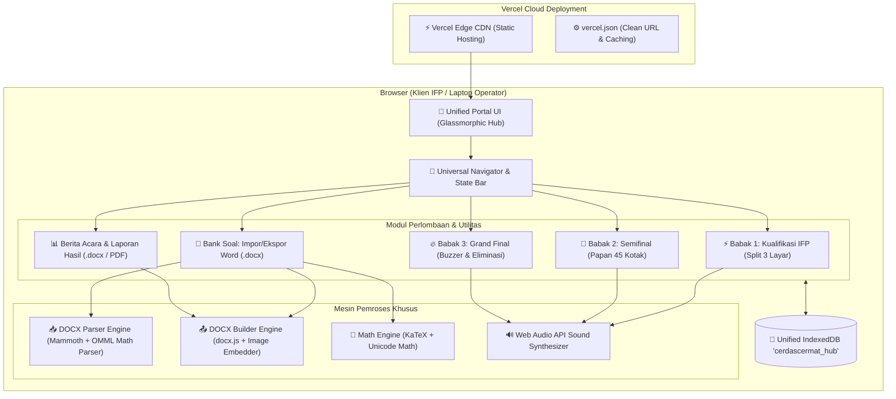

# Blueprint & Rencana Arsitektur: Portal Terpadu Cerdas Cermat IFP

Dokumen ini merinci cetak biru (*master plan*) arsitektur modern untuk menyatukan 3 aplikasi Cerdas Cermat ke dalam satu portal terpadu (*Single Access Hub*), dilengkapi mesin impor/ekspor soal Microsoft Word (dengan dukungan rumus matematika dan gambar), modul laporan resmi kegiatan, serta optimasi *zero-config deployment* ke **Vercel**.

---

## 1. Visi Produk & Filosofi Rekayasa
Sebagai Senior Full-Stack Developer, arsitektur ini dibangun dengan standar premium:
* **Keanggunan Antarmuka (*Luxury UI/UX*):** Glassmorphism halus, tema gelap/terang modern, micro-interactions, navigasi tab mengambang (*dock/app bar*), dan feedback audio dinamis.
* **Satu Pintu Akses (*Unified Hub*):** Mengintegrasikan Babak Penyisihan, Semifinal, dan Grand Final dalam satu URL/domain tanpa perlu berpindah-pindah file manual.
* **Interkoneksi Antar-Babak (*Seamless Tournament Progression*):** Hasil dan tim yang lolos dari Penyisihan dapat langsung diteruskan ke Semifinal dengan satu klik, dan 5 tim terbaik Semifinal otomatis siap dipanggil ke Grand Final.
* **Dukungan Dokumen Nyata (Word `.docx`):** Panitia/guru dapat mengunggah soal langsung dari Microsoft Word lengkap dengan persamaan matematika (Equation/LaTeX) dan gambar ilustrasi, serta mengekspor bank soal dan laporan hasil ke format Word berstandar kop dinas.
* **Kesiapan Vercel (*Vercel-Ready*):** Arsitektur berbasis web modern yang 100% *client-side reactive* dengan IndexedDB berkinerja tinggi, sehingga berjalan instan di Vercel tanpa perlu setup server database eksternal yang rumit atau berbayar.

---

## 2. Peta Arsitektur Sistem



---

## 3. Rincian Modul Utama

### A. Modul 1: Unified Hub & Navigation Bar
* **Dashboard Status Turnamen:** Menampilkan ringkasan langsung: Berapa gelombang penyisihan yang telah selesai, 9 kandidat semifinalis, 5 finalis, dan sang juara.
* **Navigasi Terpadu:**
  - `[Beranda / Hub]` : Pengaturan identitas lomba (Nama Sekolah/Acara, Tanggal, Panitia).
  - `[Babak 1: Penyisihan]` : Layar sentuh estafet IFP.
  - `[Babak 2: Semifinal]` : Papan 45 kotak giliran.
  - `[Babak 3: Grand Final]` : Arena bel rebutan & knockout.
  - `[Bank Soal]` : Pengelola soal & template Word.
  - `[Laporan & Rekap]` : Pembuat dokumen hasil kejuaraan.
* **Auto-Sync antar Babak:** Tombol *"Terapkan Pemenang ke Babak Berikutnya"* agar operator tidak perlu mengetik ulang nama-nama tim yang lolos.

### B. Modul 2: Mesin Impor & Ekspor Word (`.docx`)
Fitur ini menyelesaikan kendala utama panitia cerdas cermat:
1. **Dukungan Equation / Rumus Matematika:**
   - **Membaca Rumus:** Mendeteksi rumus Word (Office MathML / `<m:oMath>`) serta format penulisan LaTeX `$rumus$` atau `$$rumus$$`, dikonversi otomatis menjadi formula LaTeX yang dapat dirender instan oleh KaTeX di layar panggung.
   - **Mengekspor Rumus:** Menghasilkan dokumen Word dengan format equation/teks matematika yang dapat dibuka kembali di Microsoft Word tanpa rusak.
2. **Dukungan Gambar (Ilustrasi Soal):**
   - **Ekstraksi Gambar Word:** Gambar grafik, diagram rangkaian, atau peta yang ditempel di dokumen Word diekstraksi menjadi string *Base64 WebP/PNG* dan disimpan langsung di database soal lokal.
   - **Rendering di Layar:** Gambar tampil proporsional di proyektor/IFP dengan fitur klik untuk memperbesar (*lightbox modal*).
   - **Ekspor Gambar:** Saat bank soal diekspor kembali ke `.docx`, file gambar dirangkai kembali ke dalam dokumen Word secara otomatis.
3. **Template Word Resmi Panitia:**
   - Menyediakan tombol *"Download Template Soal Word (.docx)"* dengan tabel berstruktur:
     `[No] | [Kategori/Mapel] | [Pertanyaan & Gambar] | [Opsi A, B, C, D] | [Kunci Jawaban] | [Pembahasan/Skor]`.

### C. Modul 3: Laporan Hasil & Berita Acara Resmi
Menghasilkan dokumen resmi cetak dan file Word (`.docx`) siap tanda tangan:
1. **Kop Surat Lembaga:** Dapat disesuaikan (Kop Sekolah / Dinas Pendidikan / Logo Acara).
2. **Berita Acara Pelaksanaan:** Memuat waktu pelaksanaan, jumlah peserta, dan ringkasan jalannya lomba.
3. **Rekapitulasi Nilai:**
   - Tabel Nilai Babak Penyisihan per gelombang.
   - Tabel Klasemen Babak Semifinal (Poin 9 Tim).
   - Tabel Hasil Grand Final & Penentuan Juara 1, 2, 3, Harapan.
4. **Blok Pengesahan:** Kolom tanda tangan Ketua Panitia, Ketua Dewan Juri, dan Kepala Sekolah/Pimpinan.
5. **Ekspor Ganda:** Bisa langsung diekspor menjadi file `.docx` yang bisa diedit di Word, atau dicetak langsung ke PDF melalui dialog cetak browser dengan layout halaman A4 standar.

---

## 4. Struktur Proyek Siap Vercel

```
CC-Portal/
├── index.html                  # Aplikasi Utama (Single-Page Dashboard & Router)
├── vercel.json                 # Konfigurasi Vercel (Routing & Security Headers)
├── package.json                # Skrip build & dependensi
├── assets/
│   ├── css/
│   │   ├── style.css           # Desain Glassmorphism, Tema Terang/Gelap, Animasi
│   │   └── katex.min.css       # Styling render rumus matematika
│   ├── js/
│   │   ├── app.js              # Router & Pengendali Status Aplikasi
│   │   ├── storage.js          # Pengelola IndexedDB terpadu (Bank, Config, Hasil)
│   │   ├── docx-engine.js      # Mesin Impor & Ekspor Word (Equation & Gambar)
│   │   ├── report-engine.js    # Mesin Pembuat Laporan & Berita Acara (.docx)
│   │   ├── audio.js            # Efek suara Web Audio API (Bel, Benar, Salah, Ticking)
│   │   └── stages/
│   │       ├── penyisihan.js   # Logika Babak 1 (Split 3 Layar IFP)
│   │       ├── semifinal.js    # Logika Babak 2 (Papan 45 Kotak Giliran)
│   │       └── final.js        # Logika Babak 3 (Buzzer & Knockout)
│   └── vendor/
│       ├── katex.min.js        # Parser Matematika LaTeX
│       ├── mammoth.min.js      # Parser Word .docx (Text & Base64 Media Extractor)
│       └── docx.min.js         # Generator Word .docx (Client-Side Packer)
```

---

## 5. Rencana Tahapan Eksekusi

1. **Fase 1: Pembangunan Fondasi & Struktur Hub Terpadu**
   - Membuat shell aplikasi terpadu dengan navigasi bilah status, kontrol tema, dan penyimpanan IndexedDB terpusat (`cerdascermat_hub`).
2. **Fase 2: Integrasi Tiga Babak Lomba**
   - Memasukkan modul Penyisihan (3-split IFP), Semifinal (45 kotak), dan Grand Final (Buzzer knockout) ke dalam kerangka kerja terpadu.
   - Mengaktifkan fitur transfer pemenang otomatis antar babak.
3. **Fase 3: Implementasi Mesin Word (.docx) Impor/Ekspor**
   - Integrasi `mammoth` dan parser math untuk membaca soal, gambar, dan equation dari Word.
   - Integrasi `docx` library untuk mengunduh template soal dan mengekspor bank soal.
4. **Fase 4: Modul Laporan Resmi & Berita Acara**
   - Antarmuka preview berita acara interaktif.
   - Generator ekspor laporan ke `.docx` dengan tabel bergaris rapi dan kolom tanda tangan.
5. **Fase 5: Optimasi & Konfigurasi Deployment Vercel**
   - Pembuatan `vercel.json` dan pengujian *zero-error build* untuk memastikan proyek siap dipublikasikan secara global melalui Vercel.
